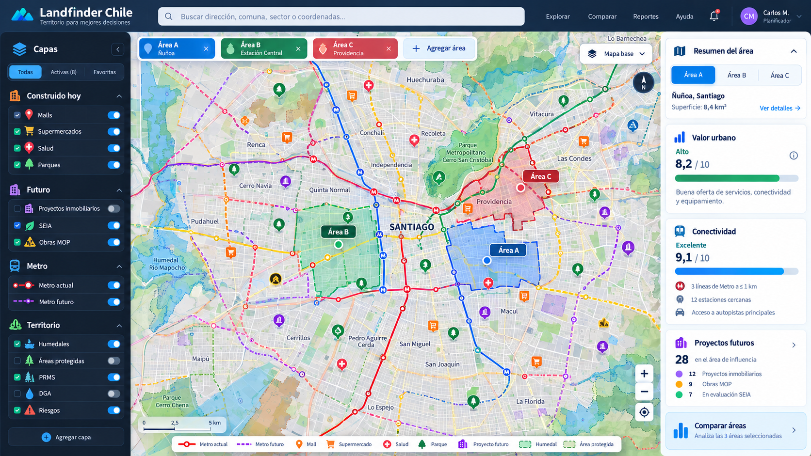

# Landfinder Chile — MVP v0.8 Map‑First SaaS

> **Encuentra, analiza y compara terrenos con inteligencia territorial.**

Landfinder Chile es un prototipo de inteligencia territorial orientado a la
búsqueda, preevaluación y comparación de terrenos. Esta versión transforma el
antiguo *Source Lab* en una interfaz **map-first** más cercana al producto
comercial futuro.



---

## Qué cambia en v0.8

La aplicación deja de estar organizada como un laboratorio de APIs y pasa a
una arquitectura de producto:

- 🗺️ **Explorar** — mapa principal de gran tamaño.
- ⚖️ **Comparar** — comparación A/B/C entre varias áreas.
- 🔔 **Alertas** — prototipo de monitoreo territorial.
- 📄 **Reportes** — exportación de evidencia JSON e informe HTML.
- 📁 **Proyectos** — workspace para organizar análisis.
- 👤 **Perfil** — usuario, empresa, rol y plan.
- 🛠️ **Admin/API** — health checks separados del producto para usuario final.

El mapa permite activar al mismo tiempo capas de:

### Construido hoy
- malls / centros comerciales;
- supermercados;
- salud;
- universidades;
- parques;
- farmacias.

### Metro
- red actual L1, L2, L3, L4, L4A, L5 y L6;
- trazados futuros/en desarrollo disponibles para L7, L8, L9 y extensiones L6.

### Desarrollo futuro
- construcciones mapeadas en OpenStreetMap;
- proyectos SEIA;
- contratos / obras MOP.

### Territorio
- MINVU;
- MMA / SIMBIO;
- DGA;
- MOP;
- SEA;
- SERNAGEOMIN;
- Bienes Nacionales;
- Energía;
- MINSAL;
- otras fuentes registradas.

---

## Selección múltiple de áreas

El prototipo permite trabajar con hasta **5 áreas simultáneas**.

Cada área tiene:

- nombre;
- sector;
- coordenada;
- radio;
- color propio.

En el mapa se mantienen visibles todas las zonas y se resalta el área activa.

También puedes hacer clic en el mapa y crear una nueva área desde el punto
seleccionado.

La pestaña **Comparar** muestra las áreas A/B/C/etc. en el mismo mapa y genera
una tabla comparativa.

---

## Indicadores

El panel derecho presenta un **indicador preliminar explicable** compuesto por:

- valor urbano;
- conectividad;
- desarrollo futuro;
- contexto territorial.

El score es solo una señal exploratoria del prototipo y **no debe tratarse
como una recomendación automática de compra ni como una certificación**.

La versión productiva debe conservar el detalle de fuentes, fecha,
disponibilidad, distancia, intersecciones y reglas utilizadas.

---

## Modelo de negocio incorporado al prototipo

### Free
- explorar mapa;
- capas básicas;
- Metro actual/futuro;
- hasta 3 áreas guardadas;
- comparación básica.

### Pro
- mayor capacidad de áreas;
- comparaciones avanzadas;
- alertas;
- reportes;
- histórico de cambios;
- capas futuras premium.

### Empresa
- workspaces;
- equipos y permisos;
- proyectos;
- reportes corporativos;
- integraciones;
- administración.

El archivo `config/business_model.json` deja este modelo separado de la UI.

---

# Instalación en Windows

## Opción fácil

1. Instala Python 3.10+.
2. Descomprime el ZIP.
3. Ejecuta:

```text
INSTALAR_Y_EJECUTAR.bat
```

4. Si el navegador no se abre, visita:

```text
http://localhost:8501
```

Después de la primera instalación puedes usar:

```text
EJECUTAR.bat
```

---

## Instalación manual

```powershell
py -m venv .venv
.\.venv\Scripts\Activate.ps1
python -m pip install -r requirements.txt
python -m streamlit run app.py
```

---

# Primera prueba recomendada

1. Entra a **Explorar**.
2. Mantén `Área A` en Santiago.
3. Activa:
   - malls;
   - supermercados;
   - salud;
   - parques;
   - Metro actual;
   - Metro futuro;
   - SEIA;
   - Límites Urbanos.
4. Pulsa **Actualizar mapa**.
5. Agrega `Área B`.
6. Activa `Consultar todas las áreas`.
7. Actualiza.
8. Ve a **Comparar**.

---

# Estructura

```text
Landfinder_MVP_v0.8_MAP_FIRST_SAAS/
│
├── app.py
├── requirements.txt
├── README.md
├── LICENSE
├── .gitignore
├── .env.example
│
├── config/
│   ├── sources_registry.json
│   └── business_model.json
│
├── landfinder/
│   ├── config.py
│   ├── registry.py
│   ├── probes.py
│   ├── runner.py
│   ├── storage.py
│   ├── map_engine.py
│   └── urban_value.py
│
├── docs/
│   ├── mockup_map_first.png
│   ├── PRODUCT_VISION.md
│   ├── ARCHITECTURE.md
│   ├── ROADMAP.md
│   └── DATA_AND_LICENSES.md
│
├── data/
└── exports/
```

---

# Arquitectura de producto

```text
Usuario
  │
  ▼
Landfinder Web / UI
  │
  ▼
Backend Landfinder (futuro FastAPI)
  │
  ├── Source Registry
  ├── Adapters
  ├── Health Monitor
  ├── Cache
  ├── Analysis Engine
  ├── Alerts
  └── Reports
       │
       ▼
Fuentes externas
```

El navegador **no debe depender directamente** de organismos públicos en la
versión productiva. Streamlit consulta fuentes de forma directa porque este
repositorio sigue siendo un MVP/prototipo local.

---

# Estado de funcionalidades

| Funcionalidad | Estado |
|---|---|
| Mapa principal | ✅ MVP |
| Múltiples áreas | ✅ MVP |
| Comparación | ✅ MVP |
| Metro actual | ✅ MVP |
| Metro futuro | ✅ MVP / sujeto a geometría disponible |
| Equipamiento construido | ✅ MVP |
| Capas territoriales | ✅ MVP |
| Proyectos futuros | ✅ MVP |
| Health monitor | ✅ MVP |
| Reporte JSON/HTML | ✅ MVP |
| Perfil demo | ✅ MVP |
| Workspaces demo | ✅ MVP |
| Alertas reales programadas | ⏳ Backend futuro |
| Autenticación | ⏳ Backend futuro |
| Persistencia cloud | ⏳ Backend futuro |
| Facturación | ⏳ Futuro |
| API pública Landfinder | ⏳ Futuro |

---

# Subir a GitHub

Crea un repositorio vacío en GitHub y, dentro de esta carpeta:

```powershell
git init
git add .
git commit -m "Landfinder Chile MVP v0.8"
git branch -M main
git remote add origin https://github.com/TU_USUARIO/TU_REPOSITORIO.git
git push -u origin main
```

No subas `.env`, credenciales, `.venv` ni la base SQLite local. Ya están
contemplados en `.gitignore`.

---

# Datos, términos y responsabilidad

La licencia MIT incluida corresponde **solo al código de este repositorio**.

Las fuentes externas mantienen sus propias licencias, políticas y términos de
uso. El `sources_registry.json` conserva un `legal_gate` por fuente.

Una fuente que responde técnicamente no implica automáticamente que esté
autorizada para explotación comercial.

Landfinder es una herramienta de **prefactibilidad**. No reemplaza:

- Certificado de Informaciones Previas;
- Dirección de Obras Municipales;
- estudios de títulos;
- factibilidades sanitarias o eléctricas;
- estudios ambientales;
- informes de riesgo;
- evaluación profesional o legal.

---

# Próximo hito

El siguiente paso recomendado ya no es agregar capas indiscriminadamente.

La evolución natural es:

1. FastAPI.
2. PostgreSQL + PostGIS.
3. usuarios/workspaces persistentes.
4. alertas programadas.
5. informes PDF profesionales.
6. comparación comercial A/B/C.
7. staging productivo.
8. validación con constructoras, EP, consultoras e inmobiliarias.
